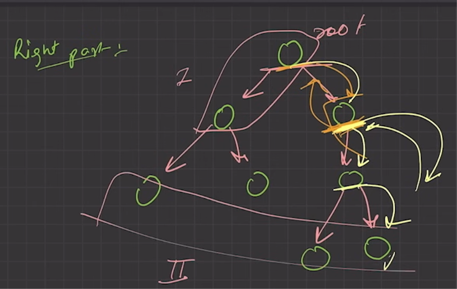

### Main function

```cpp
    vector<int> boundaryTraversal(Node *root) {
        if(root == nullptr)
            return ans;

        vector<int> ans;
        ans.push_back(root->val);

        // LEFT
        traverseLeft(root->Left, ans);

        // LEAFS
        traverseLeaf(root->left, ans);
        traverseLeaf(root->right, ans);

        // RIGHT
        traverseRight(root->right, ans);

        return ans;
    }
```

### Traverse Left

```cpp
    void traverseLeft(Node* root,vector<int> ans){
        // if only one node || if leaf node
        if(root == nullptr) || (root->left == nullptr && root->right == nullptr)
            return;

        ans.push_back(root->val);
        if(root->left)
            traverseLeft(root->left, ans);
        else
            traverseLeft(root->right, ans);
        }
```

### Traverse Leafs

```cpp
    void traverseLeaf(Node* root,vector<int> ans){
        if(root == nullptr)
            return;

        if(root->left == nullptr && root->right == nullptr)
            ans.push_back(root->val);


        traverseLeaf(root->left, ans);
        traverseLeaf(root->right, ans);

    }
```

<p align="center">
  
</p>

### Traverse Right

We have to traverse this in reverse order
=> we traverse all the way to the end & come back up while pushing_back

```cpp
void traverseRight(Node* root,vector<int> ans){
    // if only one node || if leaf node
        if(root == nullptr) || (root->left == nullptr && root->right == nullptr)
            return;
    if(root->left)
        traverseRight(root->left, ans);
    else
        traverseRight(root->right, ans);

    ans.push_back(root->val);
}

```

(INCOMPLETE)
